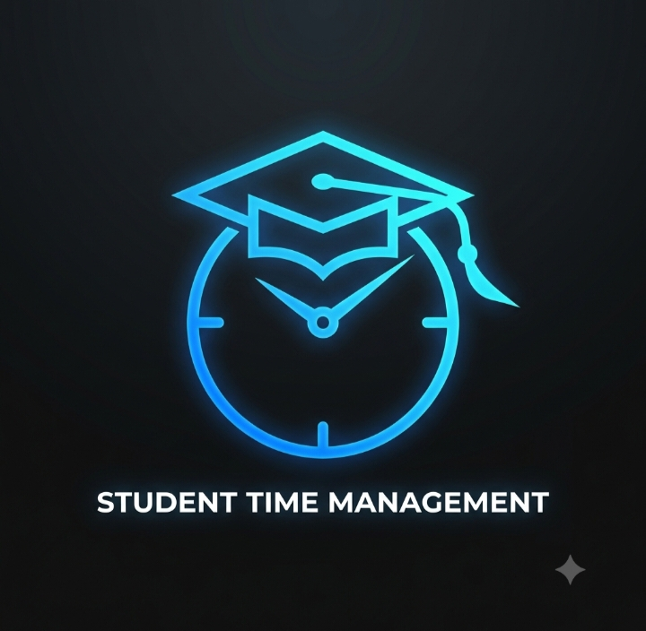

<h1 align="center">
  <br>
  
  <br>
  🎓 Student Time Management
  <br>
</h1>

<p align="center">
  <sub>Academic Task Scheduling & Focus Management</sub>
</p>

<p align="center">
  
  
  
</p>

<p align="center">
  A lightweight, responsive, and browser-based application designed to help students organize academic tasks, manage study sessions, and improve productivity.
</p>

---

## 📖 Overview

Managing academic responsibilities can become challenging when students have multiple assignments, deadlines, and study sessions to handle.

**Student Time Management** aims to simplify this process through a lightweight web application that combines task organization, time management, and productivity tracking in one place.

Built using HTML, CSS, and Vanilla JavaScript, the application focuses on simplicity, accessibility, and a responsive user experience without relying on external frontend frameworks.

### 🎯 Project Goals

- Simplify academic task organization.
- Help students prioritize assignments and deadlines.
- Encourage focused study sessions.
- Provide a clean and responsive user interface.
- Preserve user preferences and relevant application data locally.

---

## ✨ Features

- 📱 **Responsive User Interface:** Designed to provide a consistent experience across mobile, tablet, and desktop screens.
- 📝 **Task Management:** Organize academic tasks and manage their completion status.
- 📚 **Task Categorization:** Group tasks by subject and priority.
- 📅 **Deadline Management:** Keep track of upcoming academic deadlines.
- ⏳ **Pomodoro Timer:** Support focused study sessions and scheduled breaks.
- 📊 **Progress Tracking:** Monitor task completion and productivity.
- 🎨 **Dark & Light Themes:** Switch between dark and light appearance modes.
- 💾 **Theme Persistence:** Saves the selected theme in Local Storage and restores it when the application is reopened or refreshed.
- ⚡ **Lightweight Architecture:** Built with native web technologies without frontend framework dependencies.

---

## 🛠️ Tech Stack

| Technology | Purpose |
|---|---|
| HTML5 | Semantic structure and application layout |
| CSS3 | Styling, responsive layouts, themes, and animations |
| JavaScript (ES6+) | Application logic, event handling, and DOM manipulation |
| Local Storage API | Persisting application preferences and data |
| Browser APIs | Supporting browser-level application functionality |

### Design Principles

- **Vanilla JavaScript:** Uses native JavaScript without frontend frameworks.
- **Responsive Design:** Uses modern CSS layout techniques such as Flexbox, Grid, and media queries.
- **Local Data Storage:** Uses browser Local Storage for supported persistent data.
- **Maintainable Code:** Keeps application structure simple and easy to understand.

---

## 📂 Project Structure

```text
student-time-management/
│
├── Logo.jpg
├── index.html
├── style.css
├── app.js
└── README.md
```

| File | Description |
|---|---|
| `Logo.jpg` | Application logo |
| `index.html` | Main application structure |
| `style.css` | Styling, layouts, themes, and responsive design |
| `app.js` | Application logic, event handling, and data management |
| `README.md` | Project documentation |

---

## 🚀 Getting Started

Follow these steps to run the project locally.

### 1. Fork the Repository

Fork this repository to your GitHub account.

### 2. Clone Your Fork

```bash
git clone https://github.com/YOUR-USERNAME/student-time-management.git
```

### 3. Navigate to the Project Directory

```bash
cd student-time-management
```

### 4. Run the Application

Open `index.html` in your browser.

You can also use the **Live Server** extension in Visual Studio Code for local development.

---

## 💾 Data Persistence

The application uses the browser's Local Storage API to preserve supported data between sessions.

This allows users to retain relevant preferences and application information even after refreshing or reopening the browser.

### Theme Preference

The application supports dark and light themes.

- Users can switch between the available themes.
- The selected preference is saved in Local Storage.
- The saved preference is restored when the application loads again.
- Dark mode is used as the default theme when no preference has previously been saved.

---

## 🤝 Contributing

Contributions are welcome! Whether you are fixing a bug, improving the UI, enhancing functionality, or updating documentation, your contributions can help improve the project.

### Contribution Workflow

**1. Fork the repository**

Create your own fork of this repository.

**2. Clone your fork**

```bash
git clone https://github.com/YOUR-USERNAME/student-time-management.git
```

**3. Create a new branch**

```bash
git switch -c fix/your-feature-name
```

**4. Make your changes**

Implement your fix or improvement and test it locally.

**5. Commit your changes**

```bash
git add .
git commit -m "fix: describe your changes"
```

**6. Push your branch**

```bash
git push origin fix/your-feature-name
```

**7. Open a Pull Request**

Create a Pull Request from your fork to the original repository.

Please provide a clear description of your changes and explain why they are needed.

### Contribution Guidelines

- Keep changes focused and easy to review.
- Follow the existing project structure and coding style.
- Test your changes before submitting a Pull Request.
- Avoid introducing unnecessary dependencies.
- Write clear and meaningful commit messages.

---

## 🔮 Future Improvements

Potential areas for future development include:

- Enhanced task filtering and sorting.
- Additional productivity analytics.
- Customizable study and break durations.
- Improved data export and import functionality.
- Additional accessibility improvements.
- Further UI and performance enhancements.

---

## 📌 Project Status

<sub>This project is actively under development. Features and functionality may evolve as improvements and contributions are introduced.</sub>

